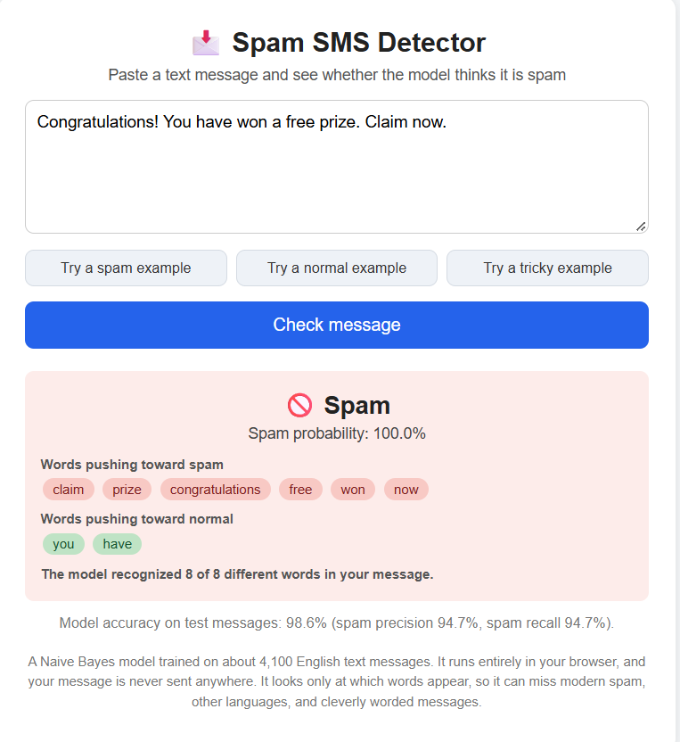

# 📩 Spam SMS Detector

Classifies a text message as **spam** or **ham** (a normal message) using Naive Bayes, and compares it with other text-classification approaches.

## 🔗 Live Demo
**[Try the website here](https://anju-raman1.github.io/Spam_SMS_Detector/)**

## Problem
Spam messages waste time and can be harmful, but a spam filter must not block real messages. This project builds a filter that learns from labelled examples, and measures it with precision and recall on the spam class, because accuracy alone is misleading when spam is rare.

## Dataset
SMS Spam Collection: 5,572 English text messages labelled as spam or ham. After removing 403 duplicate messages, 5,169 unique messages remained (about 13% spam). They were split into 4,135 training and 1,034 test messages, keeping the same spam share in both.

## Approach
- `CountVectorizer` turns every message into word counts.
- **Multinomial Naive Bayes** learns how often each word appears in spam and in ham, and combines the evidence from all the words in a message.
- Smoothing (`alpha`) was tuned with 5-fold cross-validation on the F1 score of the spam class.
- Compared with Naive Bayes + TF-IDF, Logistic Regression + TF-IDF, and a baseline that always predicts "ham".

## Results
| Model | CV F1 (spam) | Test accuracy | Spam precision | Spam recall | Spam F1 |
|---|---|---|---|---|---|
| Baseline (always ham) | 0.000 | 0.873 | 0.000 | 0.000 | 0.000 |
| Naive Bayes (alpha=0.1) | 0.943 | 0.982 | 0.924 | 0.931 | 0.928 |
| **Naive Bayes (alpha=0.5)** | **0.943** | **0.986** | **0.947** | **0.947** | **0.947** |
| Naive Bayes (alpha=1.0) | 0.934 | 0.982 | 0.959 | 0.893 | 0.925 |
| Naive Bayes (alpha=2.0) | 0.917 | 0.980 | 0.966 | 0.870 | 0.916 |
| Naive Bayes + TF-IDF | 0.928 | 0.983 | 0.975 | 0.885 | 0.928 |
| Logistic Regression + TF-IDF | 0.845 | 0.964 | 0.961 | 0.748 | 0.841 |

On the 1,034 test messages, the best model wrongly flagged 7 normal messages as spam and missed 7 spam messages.

### Changing the decision threshold
| Threshold | Precision | Recall | Ham wrongly flagged | Spam missed |
|---|---|---|---|---|
| 0.50 | 0.947 | 0.947 | 7 | 7 |
| 0.70 | 0.975 | 0.901 | 3 | 13 |
| 0.90 | 0.975 | 0.893 | 3 | 14 |
| 0.99 | 1.000 | 0.863 | 0 | 18 |

## Key Findings
- A baseline that always says "ham" gets 87.3% accuracy but catches no spam, so accuracy alone is misleading on this data.
- The simple count-based Naive Bayes beat both Naive Bayes with TF-IDF and Logistic Regression in cross-validated F1.
- The strongest spam signals are words about rewards and money: "claim", "prize", "guaranteed", "awarded", and prices such as "150p" and "500".
- False alarms are short everyday messages that use spam-like words ("text", "free", "call"). Missed spam is often spam that avoids typical spam words, such as adult-content messages, quiz competitions, and event promotions.
- A higher threshold removes false alarms (none at 0.99) at the cost of missing more spam (18 of 131).

## How the Website Works
Naive Bayes is simple arithmetic, so the learned numbers are exported to `model.json`: one score per word (how strongly it points to spam) and one starting value. `index.html` splits the message into words, adds up the scores of the words it knows, and turns the total into a probability, all in JavaScript in the browser. No server is needed, and the message is never sent anywhere. It also shows which words pushed the result toward spam or toward normal.

## Limitations
- The messages are English texts collected years ago (mainly from the UK and Singapore), so the model may miss modern spam and messages in other languages or mixed languages such as Hinglish.
- The model only looks at which words appear, not their order or meaning.
- Spammers can change their wording to avoid typical spam words.
- The file contains leftover encoded symbols ("gt", "lt") that were not cleaned.
- The test set is small, so a few messages can move the scores noticeably.

## Tech Stack
Python, pandas, NumPy, Matplotlib, Seaborn, scikit-learn, HTML, JavaScript, GitHub Pages

## Files
- `spam_sms_detection.ipynb`: full analysis, model comparison, and model export
- `index.html`: the website
- `model.json`: the exported model

## Author
Anju-Raman1 | [GitHub](https://github.com/Anju-Raman1)
